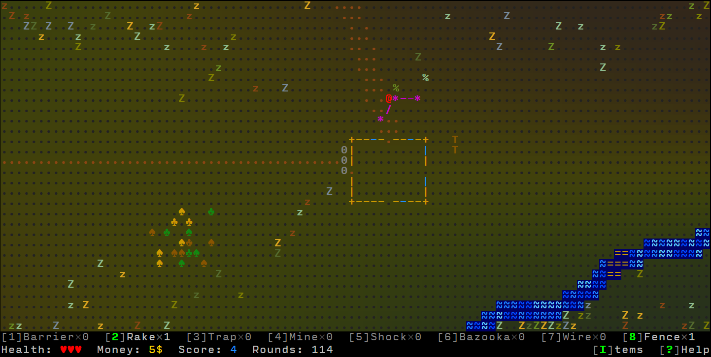

> **In the terminal:** this is the Asciiverse edition. Install and start it
> with [av](https://asciiverse.sh): `av install rogue-zombies`, then pick it
> in av. To build it yourself: `make -f asciiverse/Makefile`, then
> `./out/rogue-zombies`. What changed, and how it runs, is in
> [PATCHES.md](PATCHES.md); the licence and the author's permission in
> [PERMISSION.md](PERMISSION.md).

# Rogue Zombies: the 2024 7DRL

- [Play the game!](https://ondras.github.io/roguezombies/)
- [Manual](MANUAL.md)
- [Credits](CREDITS.md)
- [MIT License](LICENSE.md)

## The Plan

- Day #1: moving "@"
- Day #2: gameplay: items, logic
- Day #3: gameplay: items, logic
- Day #4: UI, levels
- Day #5: sfx/music
- Day #6: playtesting
- Day #7: finalize, publish, submit, PR

## The Reality

AKA the development diary

- Day #1 (Sunday 3. 3.): coffee, core structure, procrastinating with the engine, moving "@", basic ui, undecided on rendering
- Day #2 (Monday 4. 3.): ice tea, item usage, renderer autosizing, explosions, some items are working
- Day #3 (Tuesday 5. 3.): rooibos, finalizing items, procrastinating with sfx, more ui, main gameplay loop
- Day #4 (Wednesday 6. 3.): earl grey, kopr, more dialogs and levels, tutorial
- Day #5 (Thursday 7. 3.): gunpowder, terrain, docs
- Day #6 (Friday 8. 3.): raspberry tea, terrain, polish, hope level, playtesting
- Day #7 (Saturday 9. 3.): beer, explosion fx, shock item, playtesting, release

## Legacy

This game is standing on the shoulders of giants! In particular, the general idea comes from a same-named game I created back in 2011 (and is still available in the slowly-becoming-obsolete `legacy` branch). The whole source code has been thrown away for the purpose of the 7DRL challenge, but the core gameplay loop is the same.
